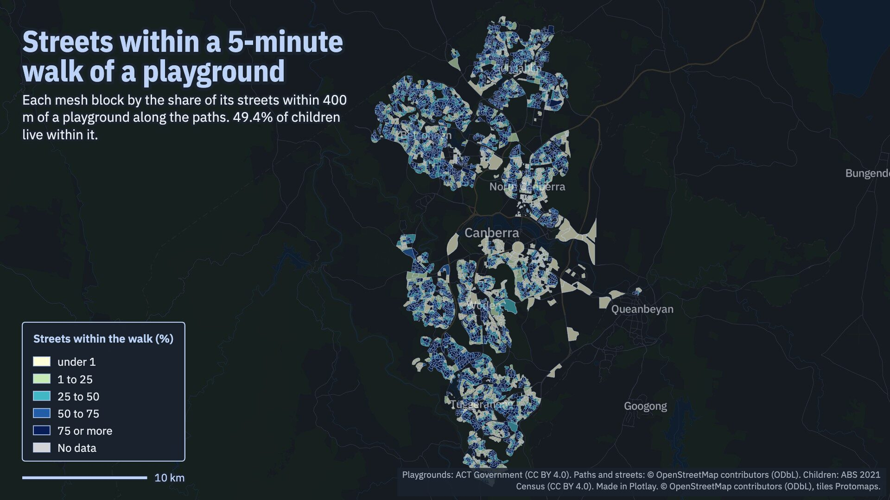

# How many Canberra children live within a five-minute walk of a playground?

The ACT Government's 537 public playgrounds, Canberra's 4,344 mesh blocks with residents and their children aged 0 to 14, and a five-minute walk (400 m along OpenStreetMap's paths and streets) from every playground, set beside a 400 m circle round each. Made with [Plotlay](https://www.getplotlay.com): the showcase page is [getplotlay.com/showcase/canberra-playgrounds](https://www.getplotlay.com/showcase/canberra-playgrounds/) and the project opens in the app at [app.plotlay.io/?example=canberra-playgrounds](https://app.plotlay.io/?example=canberra-playgrounds).

## What it shows

- **49.4% of Canberra's 82,789 children** (40,907) live within 400 m of a public playground along the paths: a five-minute walk at 4.8 km/h.
- **A 400 m circle round each playground says 81.7%** (67,652). The circles count 26,745 children the paths do not reach in five minutes.
- **Within a ten-minute walk (800 m), 94.4%.**
- 16,413 children live in mesh blocks where none of the streets are within the walk; 13,292 where all of them are.

| District | Children | Within 5 min (%) | 400 m circle (%) | Within 10 min (%) |
|---|---|---|---|---|
| Gungahlin | 20,316 | 55.0 | 85.5 | 98.0 |
| Belconnen | 19,272 | 53.7 | 87.7 | 97.5 |
| Weston Creek | 4,812 | 52.7 | 91.5 | 97.3 |
| Molonglo | 2,663 | 51.4 | 85.5 | 96.6 |
| Tuggeranong | 17,207 | 49.1 | 80.5 | 94.3 |
| North Canberra | 7,332 | 42.4 | 73.0 | 89.0 |
| Woden Valley | 6,754 | 41.7 | 76.5 | 91.3 |
| South Canberra | 4,324 | 24.5 | 52.7 | 75.2 |

The ten suburbs with 300 children or more and the smallest share within the walk:

| Suburb | Children | Playgrounds | Within 5 min (%) | 400 m circle (%) |
|---|---|---|---|---|
| Kingston | 575 | 1 | 6.6 | 28.7 |
| Yarralumla | 480 | 2 | 11.4 | 27.9 |
| Turner | 341 | 2 | 17.1 | 48.0 |
| Oxley | 332 | 2 | 20.4 | 78.6 |
| Braddon | 334 | 1 | 23.1 | 38.5 |
| Denman Prospect | 701 | 4 | 23.8 | 55.1 |
| Ainslie | 890 | 5 | 26.1 | 72.0 |
| Griffith | 683 | 5 | 26.9 | 54.4 |
| Banks | 1,092 | 3 | 28.9 | 65.8 |
| Deakin | 529 | 3 | 29.3 | 68.7 |

## Method

1. **Playgrounds**: the ACT Government's ACTGOV Playground Assets register (537 points, last updated 28 March 2026).
2. **Children**: each mesh block's residents (2021 Census mesh block counts) times its SA1's share aged 0 to 14 (2021 Census G04). The Census has no ages by mesh block, so this spreads each SA1's share evenly. Canberra here is the ACT without the Uriarra - Namadgi SA3 (the rural south and west); 31 mesh blocks over 1 km² (rural leases and reserves) are left out too.
3. **Paths and streets**: OpenStreetMap's walkable ways (footways, paths, cycleways, steps, pedestrian streets and roads where walking is not barred) from the Geofabrik extract of 22 November 2026, with the same filter as Plotlay's walking catchments.
4. **The walk**: Plotlay's walking catchments (the `walking_catchments` tool, or How far can people walk from these? in the app): from every playground at once along the network to 400 m, each playground joined at its nearest path. For each mesh block, the share of its street length (roads and pedestrian streets, not driveways or car park aisles) within the walk; its children count in that share. The same with a straight 400 m circle round each playground, and at 800 m.
5. **Checked**: an independent Python walk (`scripts/check_walk.py`, its own Dijkstra and shapely circles) on the same ways gives the same street lengths within the walk (1,285.0 km at 400 m, 2,766.1 km at 800 m) and within the circles (2,280.7 km against 2,280.8). The notebook tests the straight line a second way, from each mesh block's point: 82.7% of the children against 81.7%.

## Read it carefully

- **Children are estimated**, not counted, per mesh block (above). The ABS also adjusts small Census counts at random to protect privacy.
- **Streets stand in for homes**: a mesh block counts in the share of its street length within the walk.
- **OpenStreetMap is as mapped**: a missing path makes a walk longer than it is, a path through a locked gate shorter. 38 mesh blocks (321 children) have no street mapped and count as outside the walk.
- **A playground is a point** on the register; the walk starts at the nearest path, not the gate. School, childcare, shopping centre and private playgrounds are not on the register.
- **Five minutes is 400 m** on the flat at 4.8 km/h. Busy roads count as walkable where OpenStreetMap allows walking, with or without a crossing.

## In this repository

- `data/tables/`: `meshblocks.csv` (each mesh block: suburb, district, residents, children, street length, the shares within the walk, the circles and 10 minutes, the children within each, a point inside it), `suburbs.csv`, `districts.csv`, `playgrounds.csv`.
- `data/geometry/`: `meshblocks.geojson` (the mesh blocks with their shares) and `playgrounds.geojson`.
- `data/numbers.json`: every number on the showcase page.
- `python/canberra_playgrounds.ipynb`: a narrated notebook that gets the numbers again from `data/` and checks the straight line afresh.
- `powerbi/`: a Power BI Project (`.pbip`) with the city's cards, a map of the mesh blocks (Azure Maps), the districts, the suburbs and the playgrounds; see `powerbi/OPEN-ME.md` to open it.
- `scripts/`: the scripts that made the tables (`prep.py`, `osm_elements.mjs`, `run.mjs`, `numbers.py`) and the check (`check_walk.py`), for reference. `run.mjs` runs on Plotlay's engine, which is not in this repository; the raw downloads are not copied here.
- `visuals/`: the charts and map pictures, made in Plotlay.

## Sources and licences

- ACT Government, [ACTGOV Playground Assets](https://www.data.act.gov.au/Infrastructure-and-Utilities/ACTGOV-Playground-Assets/e4ug-7r3x) (dataACT), CC BY 4.0.
- Australian Bureau of Statistics, [2021 Census](https://www.abs.gov.au/census/find-census-data/datapacks) mesh block counts and General Community Profile G04 (SA1, ACT), CC BY 4.0. Source: ABS.
- Australian Bureau of Statistics, [ASGS Edition 3](https://www.abs.gov.au/statistics/standards/australian-statistical-geography-standard-asgs-edition-3) mesh blocks, SA1s, SA3s and suburbs and localities 2021, CC BY 4.0.
- © OpenStreetMap contributors, [Open Database Licence](https://www.openstreetmap.org/copyright), Geofabrik extract of 22 November 2026.

The tables in `data/` are made with OpenStreetMap's paths, so they are under the Open Database Licence 1.0 ([LICENSE-DATA](LICENSE-DATA)); `playgrounds.geojson` is the ACT Government's data, kept under CC BY 4.0. The visuals are CC BY 4.0 and the code is MIT ([LICENSE](LICENSE)). Details and changes in [NOTICE](NOTICE). Independent work using open data, not endorsed by the ACT Government or the ABS.
